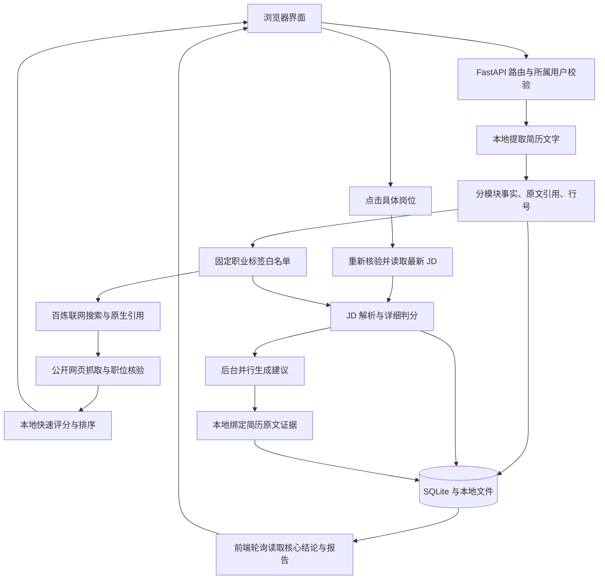

# 后端设计与分析交互

## 当前结构

OfferOS 是模块化单体：一个 FastAPI 服务提供 API、托管静态前端，SQLite 保存业务数据。前端使用原生 JavaScript，通过 HTTP API 请求与轮询更新页面。模型调用集中在百炼客户端，搜索、抽取、判分和报告采用固定流程编排。

## 模块职责

| 文件 | 职责 |
|---|---|
| `server/main.py` | 组装应用、注册路由、启动数据库与虚构样例，提供静态前端 |
| `server/routers/auth.py` | 会话与独立访客空间；个人上传和搜索不能写入共享 Demo |
| `server/routers/resumes.py`、`server/files.py` | 接收文件、本地提取 PDF/DOCX/TXT/MD 文字、提供档案与原文 |
| `server/resume_evidence.py` | 验证每个值确实位于引用原文中，记录证据 ID 与原文行号；原文之外不补候选人能力 |
| `server/demo_resume.py` | 单一完整虚构简历数据源：9 模块49条事实，由同一组字段生成原文和档案，避免示例档案与原文不一致 |
| `server/privacy.py` | 从本地档案映射固定岗位、技能、学历、粗略经验标签；移除联系方式等，限制模型出站内容 |
| `server/llm.py` | 百炼 Qwen 请求、JSON 解析、失败元信息；密钥只由后端配置读取，不进入前端 |
| `server/routers/discovery.py` | 创建搜索任务、所属用户校验、查询状态、点击岗位时重新核验并交给分析链路 |
| `server/job_discovery.py` | 搜索引用限制、公开JD抽取、在招依据检查、未知字段保留、本地快速评分与排序 |
| `server/public_fetch.py` | 公网地址和逐次跳转校验、固定已验证IP连接、HTTPS校验、大小与超时限制 |
| `server/routers/matches.py` | JD解析与判分协调、岗位和分析记录落库、缓存、启动后台报告、提供状态读取与重试接口 |
| `server/agents/jd_agent.py`、`judge_agent.py` | 使用 qwen-flash 解析公开JD、根据JD解释与候选人职业标签生成详细判断 |
| `server/agents/action_agent.py` | qwen-plus 并行生成岗位结论、要求对照、面试准备；本地保留简历原句并绑定证据 |
| `server/db.py`、`cache_store.py` | SQLite 事务、JSON字段、业务记录与版本化缓存 |

## 两种分数

列表快速分由程序计算：已识别技能覆盖70分、岗位方向30分；已识别门槛不满足时最高49分。它用于快速排序，不能解释为录用概率。

长报告沿用当前详细判断链路，对结构化JD要求和职业标签进一步分析，因此可能与快速分不同。模型的岗位要求解释仍可能误读，这正是下一步“原文锚点、JD纠错、解释结论变化”要处理的产品问题。当前没有把纠错体验标记为完成。

## 任务、并发和前端等待

搜索 API 先写入 `job_discovery_runs`，再启动进程内后台线程；一次最多两个搜索任务。每个任务最多6路搜索，同时2路，覆盖招聘平台、企业招聘系统、技能方向和公司官网等。结果不足时继续从真实引用页提取同站详情链接，不再仅在零结果时启用。默认结果上限24、候选核验预算96、网页核验并发4；去掉常见跟踪参数并合并相同岗位镜像。部分搜索失败不覆盖已得到的结果。

搜索进度、已核验岗位和统计保存到数据库，前端约每2秒读取一次并逐步展示；任务结束后开放岗位分析。新增`stats_json`自动迁移，已有搜索记录可继续读取。达到目标或预算后停止补搜，搜索质量不足时仍可能只有少量结果，不用摘要或未核验页面补数。

点击岗位的分析 API 当前仍在请求内完成最新网页核验、JD解析和详细判分，随后保存核心结论并启动后台报告线程。长报告的三个模型模块并行执行，本地简历整理不调用模型。前端约每1.8秒读取分析记录，逐步替换结果内容。

此前的跳转延迟来自前端等 API 返回才切页面。本次增加 `static/analysis-flow.js`：点击即进入结果区、聚焦稳定的结果容器并显示真实等待说明；后台返回后原位更新。导入区改成按钮控制的可折叠面板，自动带入的JD仍可展开查看。请求版本阻止旧请求覆盖新报告；失败也在结果区给出恢复入口。

这些线程属于固定工作流，便于当前本地作品集展示。它们不是独立部署的任务队列，服务重启不会自动续跑所有工作；搜索会被明确标为中断。报告任务的重启恢复、全局并发/配额与持久队列仍需增强。

## 存储、缓存与隐私

- `resumes` 保存原文、结构化档案和上传文件位置；`jobs` 保存公开JD；`match_runs` 保存分数、要求解释、报告、状态与生成来源；`job_discovery_runs` 保存搜索进度、核验结果和拒绝原因。
- JD缓存包含解析版本；判分、报告缓存包含简历事实哈希和JD解释哈希。改变简历或岗位解释后应重新计算，不能只按同一段JD原文复用旧分数。
- 真实简历只在当前用户所属空间读取。简历原文、姓名、联系方式、学校、前雇主、项目名称、精确日期不发送给模型；公开JD可以发送，候选人信息只发送固定职业标签。原文证据由本地程序补回。
- 模型请求失败或返回非法JSON时，记录来源并使用规则输出；页面可以查看哪些部分来自模型、哪些来自本地规则。
- 本地文件与SQLite尚未做静态加密；匿名访客空间没有完整的跨设备账户恢复。正式公开处理真实简历前，还需完善存储保护、数据删除策略、账户、调用限额和任务恢复。

## 本次范围

报告内容后续调整：行业现状、近半年业务动作、融资估值合并为“公司背景”。`research_agent.py`改为百炼原生联网搜索，过滤招聘页，读取有限来源后使用qwen-flash整理；引用必须属于真实搜索来源，近期事件校验日期，事实与分析分开标示。背调API支持所属分析记录校验、持久化和缓存；报告更新使用SQLite原子JSON合并，避免覆盖并行写入的公司背景。

背景结论还须提供连续原文引用；程序检查引用属于对应来源的读取正文或搜索摘要，结论中的数字必须出现在引用中。无有效引用的条目省略；若引用有效但数字改写不一致，直接展示已验证的原文并标为“原文摘录”。前端可展开依据。此检查约束原文与数值一致性，不等同于自动证明全部语义正确，也不能保证二手报道本身准确。

`interview_preparation.py`负责本地生成简历经历题、绑定原文和行号，以及兼容旧报告。职位侧题目使用qwen-flash根据公开JD和职业标签生成，保留回答要点、知识点、追问与易错点；不足的主题用标注为本地的准备提纲补充。原文外的能力和经历不补入候选事实。前端移除简历修改建议，把核心能力、加分项分组；背调与面试内容并行更新，不延迟最初进入结果区。

补齐的仅是系统维护的虚构样例及其系统复制件，不改用户上传的简历，不将示例经历添加进真实档案。主示例和共享示例都使用完整原文，49条事实均可回到相同原文核对。

## 验收记录

2026-10-23：33项Python单元/API测试通过，JavaScript语法检查、Python编译检查与Git空白检查通过。浏览器实测以虚构档案搜索到6个通过核验的岗位；点击标题即进入结果区并聚焦、导入区收起，随后原位更新为完整报告。导入按钮展开后可查看已自动读取的JD，收起正常；手动分析入口与历史分析入口也验证了结果区跳转。桌面与390px手机视口均检查，页面没有横向溢出。测试采用隔离数据库，未向真实用户简历填入示例经历。

同日扩展搜索后的实测：同一虚构档案与上海筛选，约57秒完成2路原生搜索，得到18个引用来源，从中扩展24个一跳详情，合计核验42个网页；24个岗位通过，18个链接被排除。达到24个目标后未继续启动剩余4路搜索。此次通过的岗位均来自猎聘，不将覆盖多个搜索范围等同于最终结果覆盖多个平台。结果按快速分降序，桌面与390px手机视口均无页面横向溢出。扩展后共40项测试，覆盖部分搜索失败、已有结果时继续提取详情、跟踪参数/镜像去重、候选预算、隐私边界、20条结果的API保存、逐步结果的稳定ID和分析时机。

报告结构更新后共49项测试通过，新增公司背调所属记录校验与保存、并发元数据合并、引用原文/数字校验、无来源和虚构主体、旧报告适配、两类问题内容完整性、模型短输出补齐及原文证据定位。真实AI岗位分析已验证6道本地简历问题及6道百炼职位问题，背调与报告独立生成。

## 搜索历史与换一批岗位

每次POST搜索都会新增`job_discovery_runs`行，按用户与简历归属收集所有历史行中的已保存岗位，作为本次工作流的本地排除集。创建任务时使用SQLite写事务检查同用户正在进行的搜索，避免并发请求同时以旧历史开始搜索。更改城市、方向或招聘类型仍沿用同一份简历的历史排除；另一份简历或其他用户不共享历史。

排除分两步：先比较标准化候选URL，节省重复抓取；抓取后再比较最终跳转URL及公司、职位、城市标识，拦住镜像与修改后的相同岗位。历史排除独立统计，已知候选URL直接跳过，不占核验预算；抓取后才识别的重复仍计入网页核验预算。模型只接收最多48条公开排除URL，用于搜索引导；本地检查使用完整历史，不受48条上限限制。相同公司/职位/城市下的不同部门可能被保守合并，这是避免重复的取舍；不将已核验岗位数不足转成重复填充。

GET搜索列表按创建次序返回全部页的轻量元信息，包括页码、时间、条件、状态、数量，不包含JD和全量岗位。GET单页仍严格检查归属并省略JD。历史分析入口绑定明确的run_id和item_id，重新核验招聘页面后才启动报告。旧页结果不因新搜索而重写；服务重启中断的页仍保留已经核验的部分结果。

前端把正在轮询的任务与正在查看的页分开：轮询只更新对应页缓存、数量和状态，只有用户正在该页时才更新列表。页选与简历切换有请求版本保护，迟到响应不能覆盖新选择；当前页按简历ID保存在sessionStorage，返回报告或刷新后恢复。数据库是持久历史来源，sessionStorage仅保存查看位置。

本轮53项Python测试及4项Node交互测试通过。新增覆盖跨历史跟踪链接/跳转/修改JD的镜像排除、超过48条历史的完整本地拦截、零新增不回填、历史顺序与结果不变、归属及简历隔离、旧页分析、后台搜索与历史浏览分离、延迟请求不覆盖新选择、报告生成中返回历史页，以及中断搜索已展示岗位的保存与下次排除。

浏览器实测：原第1页6个岗位、第2页24个岗位均保持原样，第3页新增2个可靠岗位，与前两页的招聘链接交集为空；检查36个网页，其余34个未通过核验。搜索第3页期间成功浏览第2页并点击历史岗位进入结果区，已返回长报告；刷新后恢复第3页。桌面1280px及手机390px检查无横向溢出，独立界面审查结论ship。截图保存在`.impeccable/review/discovery-history-desktop.png`、`discovery-history-mobile.png`和`discovery-history-completed.png`。

## 项目清理（2026-10-23）

清理以运行入口和引用为依据，保留全部已注册业务接口、数据库结构、简历及搜索历史。删除旧登录/注册HTML（路由已直接跳转到Demo）、缺少源文件的旧文档生成脚本，以及16份已被最终截图替代的验收草稿、网页抓取副本和JSON临时结果；保留产品文档成品、设计资料和当前验收截图。移除36个Python字节码缓存及5个空缓存目录、空tools目录。QA目录加入Git忽略，预览数据继续保留在隔离目录。

移除未调用的curl/Jina抓取分支、截图分片与云端识图实现、旧简历模型提示、未调用工具函数和失效环境变量；依赖表移除Pillow。公共网页仍统一走固定公网IP核验，旧截图API继续明确返回410。浏览器粘贴/拖入截图仅在本地提示停用，删除不再使用的预览、上传、识别状态和样式。跨简历证据加载及永不执行的模型分支一并删除，报告只使用当前档案。

本轮54项Python测试、4项Node交互测试、全部JavaScript语法与Python语法检查通过。新增入口及所链接静态资源检查，验证登录跳转、管理员页面、健康状态和停用截图API；保留原有隐私与搜索历史回归覆盖。浏览器重启后验证3页历史仍在、当前页恢复、简历档案和岗位清空操作正常。源码删除前的恢复副本保存在项目外系统临时目录，实际.env和data未改动。
